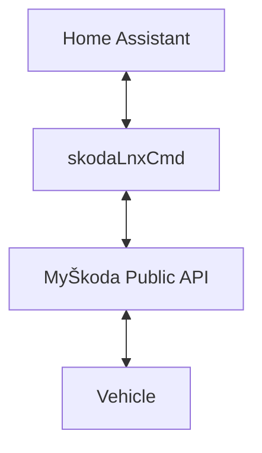

# SkodaLnxCmd
This add-on provides access to the MyŠkoda API.


## Configuration
### SKODA_VIN
The 17-character VIN of the vehicle.
### SKODA_KEY
The API key from MyŠkoda.
### SKODA_PIN
The security PIN key from MyŠkoda.

> [!NOTE]
> Home Assistant may report the Škoda S-PIN as a pwned secret. This is expected. Škoda uses a 4-digit S-PIN to provide
> additional security for certain vehicle functions. Since only 10,000 possible PIN combinations exist, many valid S-PINs
> are present in password breach databases and may trigger this warning. The warning can be safely ignored.

## Config files

The plugin does not, support auto-setup. This as to be done manually, but the app generates a config based on data from
HA and Škoda API.

1. Generate/fetch VIN, key and pin from MyŠkoda phone App.
2. Set VIN, key and pin on the apps config page.
3. Open the app's webpage in HA.
4. Follow the instructions on the page.

The template for the config file can be fetched from:<br>
https://raw.githubusercontent.com/mem76/skodaLnxCmd-ha-addon/refs/heads/master/skodalnxcmd/sample.skoda.yaml

# Tips & Tricks

## Rate limiting
The Škoda API has a very low rate limit, this application use adjustable cache time in order to compensate. By default, the cache-timeout is just shy of 5 min, but with heavy API usage the cache time will increase in order to compensate.

For this reason it is recommended for automation to run less frequent. Note "read" functions are cached. 

An additional reason for using low automation frequency is that  sending the commands from Škoda's servers to the car can take some time.

```
# Bad automation example
# Check every min to test if charger can start.
12:00:00: test ( can_start && charger_off ) => start charger
12:00:02: "Start Charge sent to API, qued to car"
12:00:03: Cache purged
12:01:00: test ( can_start && charger_off ) => start charger
12:01:02: "Start Charge sent to API, qued to car"
12:01:03: Cache purged
12:02:00: test ( can_start && charger_off ) => start charger
12:02:02: "Start Charge sent to API, qued to car"
12:02:03: Cache purged
12:02:19: Car reports to Škoda "Charging started"
12:03:00: test ( can_start && charger_off ) => abort (car is charging)
```
You have now used 7 API calls of the 20 allowed per hour.

## Charge efficiency

Modern EV have a high idle power usage, resulting in high losses if charged at low charge rate. Most model (as of 2026) only support "Current limiting" option that limits the current to 8A. It may be better that you automations pause/resume the charge in sted of toggeling the "Current limiting" option.

